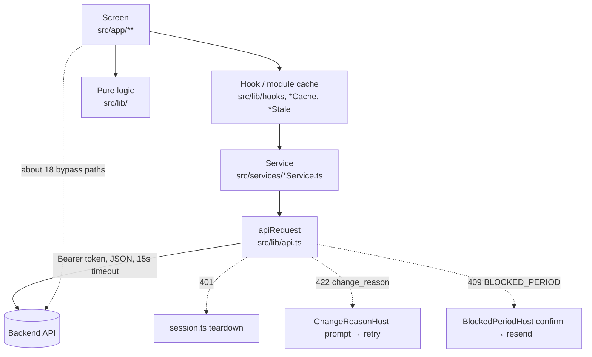

# ZapZone Mobile — Architecture Overview

> **Purpose:** Overview of how ZapZone Mobile actually works, its architectural boundaries and its known exceptions.
> Detailed subjects are in [`architecture/`](architecture/).
> **Status:** Baseline (descriptive). Documents existing behaviour; not a requirements source.
> **Last reviewed:** 2026-11-26
> **Inspected revisions:** Mobile `973d281`; Backend `zapzone-backend@ae877e2` (cited sections only)
> **Scope & limitations:** Static source inspection only. Nothing was run, type-checked, tested or device-verified.
> Per-controller Backend scoping was only partly assessed (see
> [architecture/location-and-role-access.md](architecture/location-and-role-access.md)).
> **Related:** [Index](README.md) · [Project overview](PROJECT_OVERVIEW.md) ·
> [Development guidelines](DEVELOPMENT_GUIDELINES.md) · [Known limitations](KNOWN_LIMITATIONS.md)

## Detailed architecture documents

| Subject | Document |
|---|---|
| Startup, auth guard, session store, saved accounts, sign-out | [architecture/startup-auth-and-session.md](architecture/startup-auth-and-session.md) |
| `apiRequest` lifecycle, services and hooks, bypass inventory, representative traces | [architecture/api-layer-and-data-flow.md](architecture/api-layer-and-data-flow.md) |
| Roles, navigation gating, global and staff location, what the Backend enforces | [architecture/location-and-role-access.md](architecture/location-and-role-access.md) |
| Booking cache and incremental sync, metrics cache, stale flags, refresh patterns | [architecture/caching-and-synchronization.md](architecture/caching-and-synchronization.md) |
| Device storage, env vars, logging and error reports, payment data, PII | [architecture/security-and-data-handling.md](architecture/security-and-data-handling.md) |
| Router structure, motion, modals and sheets, design kit, styling, theme, safe areas, keyboard | [architecture/ui-navigation-and-styling.md](architecture/ui-navigation-and-styling.md) |
| Camera, media, files, sharing, print, calendar, push, updates, intent launcher | [architecture/native-integrations.md](architecture/native-integrations.md) |
| app.json and eas.json, versions, OTA/runtime, update gate, platform readiness | [architecture/platform-and-release.md](architecture/platform-and-release.md) |
| Test tooling, test inventory, gaps, lint and type-check | [architecture/testing-and-quality.md](architecture/testing-and-quality.md) |

## Repository structure

| Path | Responsibility |
|---|---|
| `src/app/` | Expo Router routes: 129 files. Only two layouts exist: the root `Stack` (`_layout.tsx`) and `(tabs)/_layout.tsx`. Module folders (`bookings/`, `packages/`, `waivers/`, …) have no layouts; their screens are pushed onto the root stack. |
| `src/components/` | Shared UI. `ui/` (about 187 files: design kit, sheets, tables, badges, forms), `navigation/` (tab bar, FAB, motion), and domain folders (`checkin/`, `photos/`, `events/`, `waivers/`, …), plus app-shell components (`AuthGuard`, `AppUpdateGate`, `ErrorBoundary`, push registrar/router). |
| `src/services/` | 55 API service modules. These are thin wrappers that call `apiRequest` with an explicitly passed token and map responses. |
| `src/lib/` | Pure logic by domain (`bookings/`, `payments/`, `waivers/`, …) with `*.test.ts` unit tests; reactive stores (`session.ts`, `location/activeLocationStore.ts`, `accounts/*`); `hooks/` (46 data hooks); `api.ts`. |
| `assets/` | Icons, splash image, fonts and brand images. |
| `docs/` | This documentation. |
| `.specify/`, `.claude/skills/speckit-*` | GitHub Spec Kit v1.4.3 infrastructure (SDD). |
| Root configs | `app.json`, `eas.json`, `tsconfig.json`, `babel.config.js`, `metro.config.js`, `tailwind.config.js`, `eslint.config.js`. The JS configs **execute at bundle time** (see [security](architecture/security-and-data-handling.md)). |

## Layered data flow

- **Screens own orchestration and state.** Hooks fetch and cache, services map HTTP calls, pure helpers hold the
  rules that are tested.
- **Tokens are passed explicitly** from `getToken()` into services. Only `src/lib/session.ts` owns the token.
- **Global response handling** in `apiRequest`:
  - a 401 tears down the session once and leaves the request pending forever (`neverSettles`); a stale-token
    guard prevents a newer session being torn down;
  - a 403 surfaces as an error;
  - a 422 `change_reason` triggers a prompt and one retry;
  - a 409 `BLOCKED_PERIOD` triggers a confirmation and a resend with acknowledged block IDs;
  - other failures become an `ApiError` and are sent to the client error reporter.
- **Exceptions:** about 18 request paths bypass `apiRequest`. They include multipart uploads, file downloads,
  Authorize.Net tokenisation, account-switch validation, push unregistration and error reports. These paths have
  different timeout, 401 and reporting behaviour; see the API document §6 (`KL-ARCH-002`).

## Startup and session

1. `expo-router/entry` → `src/app/_layout.tsx` (`RootLayout`). It keeps the splash screen up and renders nothing
   until fonts load and hydration finishes. Hydration restores saved accounts, then the session, then the
   per-user timeframe, then validates the token against `GET /api/user` (8 s). Theme and workspace location are
   restored in parallel.
2. The shell mounts the `ErrorBoundary`, `AuthGuard`, push registrar and router, the root `Stack`, `AppUpdateGate`,
   `ChangeReasonHost` and `BlockedPeriodHost`.
3. `splash.tsx` (`handOff`) alone decides where launch goes (`/home` or login). `AuthGuard` redirects signed-out
   users off non-public routes, slides the inactivity window, and expires idle sessions.
4. The session is a reactive store built on `useSyncExternalStore` and persisted in SecureStore. The window is
   `SESSION_TTL_MS`, currently a **TEMP 30-day** value (`KL-SEC-001`).

Saved accounts (up to 5) are switched through the `/switch-account` bridge, which remounts the tab tree. Sign-out
unregisters push *before* revoking the token. Details:
[startup-auth-and-session.md](architecture/startup-auth-and-session.md).

## Roles, location and authorisation

- **Roles** are `company_admin`, `location_manager` and `attendant`. The Backend also knows an `admin` role that
  the Mobile UI does not model (`KL-ARCH-004`).
- **Mobile role checks are UI gating only.** They decide tabs (`navConfig.getRoleTabs`), Quick Nav entries and
  buttons. **Authorisation is the Backend's job**: `auth:sanctum`, the `EnsureStaff` middleware, the
  `ScopesByAuthUser` company/location scoping, and per-action checks inside controllers. Coverage is **not uniform**.
  Some routes are public or lack `staff`; some controllers skip the scoping trait; some settings are honoured only in
  the UI. Don't assume a rule is server-enforced until the Backend code has been read. Known gaps are recorded as
  `KL-SEC-*` and module `KL-*` items.
- **Company admins** pick a global workspace location (`activeLocationStore`). It is persisted, reset on account
  change, and read by about 59 files.
- **Managers'** active location lives on their **token, server-side**. The app re-syncs it on login, launch,
  switch and in-app change.

Details: [location-and-role-access.md](architecture/location-and-role-access.md).

## Caching and synchronisation

- **Bookings:** an in-memory list cache owned by the current token. It merges an `updated_since` change feed and
  does a full re-download every 30 minutes or when totals disagree. Mutations call `markBookingsStale()`.
- **Dashboard metrics:** a file-system cache (`Paths.cache`) with a 5-minute per-user snapshot.
- **Other modules:** module-level caches with `mark*Stale` / `consume*Stale` flags, refetched when the screen
  regains focus. Most lists are **loaded in full, then filtered and paginated on the device** (`fetchAllPages`,
  using a request pool).

Details: [caching-and-synchronization.md](architecture/caching-and-synchronization.md).

## UI, navigation and styling

- **Tabs:** a custom floating tab bar whose tabs depend on role. `QuickNavFab` is mounted **inside the `(tabs)`
  layout**, so it does not appear on pushed screens.
- **Module landing pages** are built with `ModuleHubScreen`.
- **Motion:** all constants live in `navMotion.ts`. Every stack screen gets an entrance through `screenLayout`
  (`ScreenEnter`). `"ios_from_right"` is an Android-only value, so iOS uses its native push.
- **Overlays:** `BottomSheet` (React Native `Modal`, about 103 consumers) and `CenterModal`. Modals are opened one
  at a time, sequenced with timeouts (`KL-UI-010`).
- **Styling:** NativeWind 4 classes for static styles; inline `style` or Reanimated for animated and computed
  values. There are no colour tokens; the brand colour is hard-coded. The theme is app-controlled light/dark,
  persisted in SecureStore. Montserrat is applied by patching `Text`/`TextInput`.

Details: [ui-navigation-and-styling.md](architecture/ui-navigation-and-styling.md).

## Platform, native integrations and release

- **Versions:** Expo SDK 55.0.28 and React Native 0.83.10. The `appVersion` runtime policy (1.2.3) is shared by
  both platforms, and the EAS channels are also shared.
- **Android** is the only platform in use. It has an in-app APK update path using `expo-intent-launcher`.
- **iOS** isn't configured: no bundle identifier, the template icon, and a dev-client profile without the
  package installed (`KL-PLAT-*`).
- **Native modules** are mostly lazy-imported where they're used.

Details: [native-integrations.md](architecture/native-integrations.md) and
[platform-and-release.md](architecture/platform-and-release.md).

## Architectural boundaries (as observed)

These are observations of the current code. Which of them become mandatory is decided in Phase 3.

- Network traffic goes through `apiRequest`, except for the documented bypass paths.
- The token is held only by `session.ts`. Per-account state is reset when the account changes.
- The location scope comes from `activeLocationStore` (company admins) or the server-side token (managers).
- Role-based navigation is configured in `src/lib/navigation/navConfig.ts`.
- Navigation and overlay timing are configured in `src/components/navigation/navMotion.ts`.
- App-wide overlays and prompt hosts mount once in the root layout.
- Testable rules live in pure `src/lib` modules that import no native modules at runtime.

## Known architectural exceptions and inconsistencies

| Topic | Observation | Ref |
|---|---|---|
| Login 401 | A wrong password returns 401, which triggers the global session teardown and leaves the login request pending. The add-account flow can tear down the live session. | `KL-ARCH-001` |
| Request bypasses | About 18 paths skip `apiRequest`, with inconsistent timeout, 401 and reporting handling. | `KL-ARCH-002` |
| Pending requests | `neverSettles` can leave submit locks and spinners set. | `KL-ARCH-003` |
| Session expiry | The expiry time is persisted but never read back. TEMP 30-day TTL; Home polling keeps sliding it. | `KL-SEC-001` |
| Role model | The `admin` role is absent from Mobile types, navigation and the location selector. | `KL-ARCH-004` |
| UI role gates | Gates are scattered and differ from Backend rules in several modules. | Module `KL-*` |
| Feedback UX | 768 `Alert.alert` calls vs 6 `useStatusModal` users. | `KL-UI-004` |
| Design kit | Partial migration: 22 screens use `ModuleHeader`; older headers remain. | `KL-UI-001`, guidelines |
| Safe areas and keyboard | Fixed `pt-12` headers; `BottomSheet` has no keyboard avoidance. | `KL-UI-001`–`003` |
| Debug code | TEMP `authDebug` instrumentation is still wired in. | `KL-ARCH-005` |
