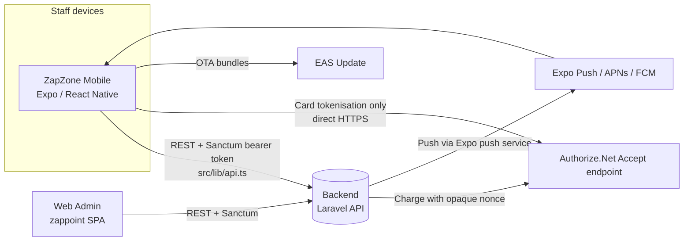

# ZapZone Mobile — Project Overview

> **Purpose:** What ZapZone Mobile is, who uses it, what it covers, and how it relates to Web Admin and Backend.
> **Status:** Baseline (descriptive). Supersedes [MOBILE_APP_OVERVIEW.md](MOBILE_APP_OVERVIEW.md).
> **Last reviewed:** 2026-11-26
> **Inspected revisions:** Mobile `973d281`; Web Admin `zappoint@5de9d9e`; Backend `zapzone-backend@ae877e2`
> **Scope & limitations:** Static inspection only. Product objectives marked *(inferred)* are interpretations of
> the code, not owner-stated goals. Per-module detail is in the [feature catalog](FEATURE_CATALOG.md).
> **Related:** [Documentation index](README.md) · [Feature catalog](FEATURE_CATALOG.md) ·
> [Architecture](ARCHITECTURE.md) · [Known limitations](KNOWN_LIMITATIONS.md)

## Identity

| Item | Value | Source |
|---|---|---|
| Display name | ZapZone Admin | `app.json` (`expo.name`) |
| Repository / Expo slug | `zapzone-analytics-app` | `app.json` (`expo.slug`) |
| App version | 1.2.3 | `app.json` (`expo.version`) |
| Android package | `com.zapzone.analytics` | `app.json` (`expo.android.package`) |
| iOS bundle identifier | **Not configured** | `app.json` (`expo.ios` has only an icon) |
| Deep-link scheme | `zapzoneanalyticsapp` | `app.json` (`expo.scheme`) |

The repository name reflects the app's origins as an analytics viewer. The app has since become a broad staff
operations tool.

## Purpose and business context

ZapZone runs multi-location family-entertainment venues. They sell attractions, party and booking packages,
events, memberships and escape-room games, under a **Company → Location** structure. The Web Admin portal is the
full back-office tool, and the Laravel Backend serves both it and this app.

ZapZone Mobile puts that back office **on a phone for venue staff**: dashboards and analytics, plus day-to-day
operations at the venue. Those operations include taking and changing bookings, selling tickets on site,
checking guests in by QR code, running waivers and the waiver kiosk, capturing and delivering guest photos,
recording payments and managing catalogue and staff records.

*(Inferred objectives)* The code points to three aims: Web Admin parity for staff workflows, mobile-first handling
of floor operations, and reuse of the existing Backend API with no separate mobile backend. The Backend does
expose a small set of `mobile/*` endpoints.

## Target users

Staff roles returned by the Backend (`src/services/auth.ts`, `UserRole`):

| Role | Typical use in the app |
|---|---|
| `company_admin` | Company-wide view across locations: global workspace location selector, User Management, company analytics |
| `location_manager` | One location (or several, switched on the server-side token): Activity tab, Attendants Management, location analytics |
| `attendant` | Floor staff; gets the default tab set and is excluded from push registration |

Customers are **not** users of this app. Customer-facing booking, the storefront, and public registration and
waiver-signing pages belong to the web front end. The client-side navigation gating behind these roles is
described in [architecture/location-and-role-access.md](architecture/location-and-role-access.md). That document
also separates what the Backend actually enforces.

## Scope: major capabilities

Grouped by domain. Status per module is in the [feature catalog](FEATURE_CATALOG.md).

- **Dashboards and activity:** role-specific home dashboards, location overview, manager activity feed, calendar tab.
- **Bookings and scheduling:** booking list and detail, create and edit, manual booking (including custom
  packages), booking calendar, space schedule, location change requests, availability blocks (day-offs).
- **Attractions and events:** catalogue management, on-site ticket and event purchases, bulk (ticket) orders,
  registration forms, purchase details with QR codes.
- **Check-in:** unified staff check-in desk with QR scanning and guest lookup.
- **Catalogue and pricing:** packages, custom packages, add-ons, spaces, gift cards, promo codes, special
  pricing, fee support, global notes.
- **Customers, waivers and memberships:** customer records and analytics, customer concerns, visitor tracking,
  waiver records, templates, ads, group invites, in-app waiver kiosk, memberships, plans and reports.
- **Photos and escape rooms:** staff photo capture and delivery, library, overlays, slideshow, escape-room games and kiosk.
- **Communications:** email campaigns, templates, notification settings, SMS notifications, in-app
  notifications, push notifications.
- **Administration and analytics:** user/attendant management, staff PINs, activity logs, accounting,
  performance and page analytics, payments, deleted payments, package invoices, settings, profile, saved accounts.
- **App maintenance:** in-app version check and an Android in-app APK update flow.

## Technology stack (installed versions at `973d281`)

| Layer | Technology |
|---|---|
| Runtime | Expo SDK 55 (`expo` 55.0.28), React Native 0.83.10, React 19.2.0 |
| Language | TypeScript 5.9.3 (strict) |
| Navigation | Expo Router 55.0.17 (typed routes enabled), React Navigation 7, react-native-screens 4.23.0 |
| Styling | NativeWind 4.2.6 on Tailwind CSS 3.4.19; Montserrat via `@expo-google-fonts/montserrat` |
| Animation and gestures | Reanimated 4.2.1, react-native-worklets 0.7.4, react-native-gesture-handler 2.30.1 |
| Native modules | expo-camera, image-picker, media-library, file-system, sharing, print, document-picker, calendar, notifications, secure-store, updates, and others (see [architecture/native-integrations.md](architecture/native-integrations.md)) |
| Build and release | EAS Build and EAS Update; `runtimeVersion` policy `appVersion` |
| Tooling | npm (`package-lock.json` v3); Node's built-in test runner for `src/**/*.test.ts`; ESLint via `expo lint` |
| Compiler experiments | React Compiler and typed routes enabled (`app.json` `experiments`) |

Reference systems: the **Backend** is Laravel ~12.48 with Sanctum 4 (bearer tokens) on PHP ^8.2. **Web Admin** is
React 19, Vite 7, React Router 7 and Tailwind 4. Both are declared ranges from their manifests at the inspected
revisions.

## System context

- **Backend** is the single data source and the authority for API contracts, authorisation and server-side
  validation.
- **Web Admin** is the reference for intended business behaviour. Mobile frequently ports Web Admin features,
  adapted for mobile.
- **Mobile** talks to the Backend through one shared client, with documented exceptions in
  [architecture/api-layer-and-data-flow.md](architecture/api-layer-and-data-flow.md).
- **Payments:** card data goes from the device straight to Authorize.Net, and only an opaque nonce is posted to the
  Backend's `POST /api/payments/charge`. The Backend charge handler itself was not assessed in this baseline
  (`KL-PAYMENT-006`).

## Platform support

| Platform | Status |
|---|---|
| Android | **In use.** EAS build profiles, an in-app APK update path, and Android-specific permissions are configured. |
| iOS | **Not yet supported.** No bundle identifier and a default template icon. No evidence of an iOS build or device test was found in the repositories, and none was attempted for this baseline. Readiness concerns are listed in [KNOWN_LIMITATIONS.md](KNOWN_LIMITATIONS.md) and [architecture/platform-and-release.md](architecture/platform-and-release.md). |
| Web | An Expo web export configuration exists (`app.json` `web`), but web is **not assessed** as a product target. |

## Development context

- Two developers, both on Windows with VS Code and Claude Code. Code reaches `main` through commits and merges
  (see `git log`). There is no CI configuration in the repository.
- Spec-Driven Development is being adopted with **GitHub Spec Kit v1.4.3** (`.specify/`, `.claude/skills/speckit-*`).
  The project constitution (`.specify/memory/constitution.md`, v1.0.0) was ratified on 2026-11-26.
- AI instructions: `CLAUDE.md` imports `AGENTS.md`. It says to read the Expo v55 versioned docs before writing
  code, follow the constitution, and load `docs/` selectively starting from `docs/README.md`.

## Current development status

Active development. Recent work centres on Web Admin parity ports, such as Custom Package on Manual Booking,
which landed in the same week across all three repositories. Most modules are implemented and source-verified,
but **none has been runtime-verified as part of this baseline**. Automated tests cover pure logic in `src/lib`
only. See [architecture/testing-and-quality.md](architecture/testing-and-quality.md).

## Known scope boundaries

- Not in Mobile: customer-facing storefront and booking site, public registration pages, and web-only signing
  flows. Details are in the feature documents.
- Many rules are enforced **only in the Mobile client**, as UI gates or client-side calculations. Examples include
  several role gates and staff-side price totals. Where Mobile, Web Admin and Backend disagree, the
  [business rules register](BUSINESS_RULES.md#cross-repository-discrepancies-requiring-decisions) records it.
- iOS support and future feature specifications are later SDD phases.
