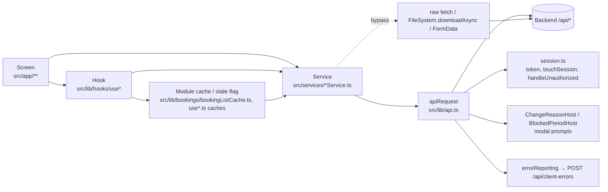
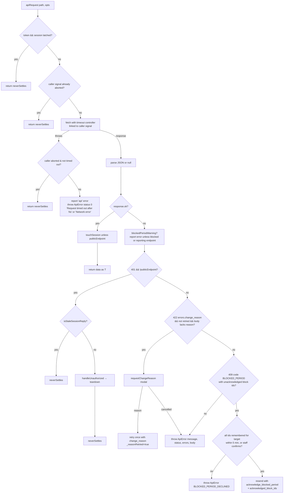

# API Layer and Data Flow

> **Purpose:** Describe how the mobile app talks to the backend — the shared `apiRequest` client, its error/retry semantics, the service and hook layers, and every request path that bypasses the shared client.
> **Status:** Baseline (descriptive) — documents existing behaviour; not a requirements source
> **Last reviewed:** 2026-11-25
> **Inspected revisions:** Mobile `973d281`; Backend `zapzone-backend@ae877e2` (cited sections only)
> **Scope & limitations:** Read in full: `src/lib/api.ts`, `src/lib/staleSessionReply.ts`, `src/lib/changeReasonPrompt.ts`, `src/lib/errorReporting.ts`, `src/lib/errorReportGate.ts`, `src/lib/fetchAllPages.ts`, `src/lib/mediaPath.ts`, `src/lib/hooks/useAsyncList.ts`, `src/lib/hooks/useBookings.ts`, `src/lib/bookings/bookingListCache.ts`. Read in part: `src/lib/blockedPeriodPrompt.ts`, `src/services/bookingsService.ts`, `src/services/paymentsService.ts`, `src/lib/payments/acceptTokenize.ts`, several screens. The ~50 service modules were **not** individually reviewed; the bypass inventory in §6 comes from a repo-wide search for `fetch(`, `FormData`, `downloadAsync`, `createDownloadResumable` and is believed complete for those patterns at `973d281`. Backend: route table and `CapturesChangeReason` / `AvailabilityBlockGuard` existence only.
> **Related:** [Architecture overview](../ARCHITECTURE.md) · [Business rules index](../BUSINESS_RULES.md) · [Known limitations](../KNOWN_LIMITATIONS.md) · [Startup, auth & session](startup-auth-and-session.md) · [Location & role access](location-and-role-access.md) · [Caching & synchronization](caching-and-synchronization.md) · [Security & data handling](security-and-data-handling.md) · [Core platform rules](../business-rules/core-platform-rules.md)

---

## 1. Layering



- **Screens** read the token with `getToken()` / user with `getCurrentUser()` and pass `token` explicitly into hooks/services. There is no implicit auth header injection: `apiRequest` only sends `Authorization` when a caller passes `token`.
- **Services** (`src/services/*Service.ts`, ~50 modules, one per backend domain) build paths/query strings, call `apiRequest<T>`, and map raw API shapes into app types. Example: `fetchAllBookings` / `fetchBookingChanges` / `updateBooking` in `src/services/bookingsService.ts`.
- **Hooks** (`src/lib/hooks/use*.ts`) own loading/error state and request-sequencing. Common pattern: a `requestIdRef` counter so only the latest load writes state, effect cleanup bumps it on unmount (`useAsyncList`, `useBookings`, `useLocationOptions`).
- **Module-level caches** sit between hooks and services for heavy lists (see [caching-and-synchronization.md](caching-and-synchronization.md)).

## 2. `apiRequest` lifecycle (`src/lib/api.ts`)

### 2.1 Configuration

| Item | Behaviour | Evidence |
|---|---|---|
| Base URL | `process.env.EXPO_PUBLIC_API_URL`, trailing slashes stripped; **module import throws** if unset. Inlined at bundle time. `__DEV__` logs the resolved URL. | `API_BASE_URL` IIFE |
| Web URL | `EXPO_PUBLIC_WEB_URL` (optional) else falls back to the API base. Used by `webUrl()` for customer-facing links. | `WEB_BASE_URL`, `webUrl` |
| Headers | `Accept: application/json`, `Content-Type: application/json`, `Authorization: Bearer <token>` only when `token` passed. Body is `JSON.stringify(body)`. | `apiRequest` |
| Timeout | `DEFAULT_TIMEOUT_MS = 15000`; per-call `timeoutMs` override (e.g. dashboard metrics, version check, guest waiver calls). Implemented with an internal `AbortController`. | `DEFAULT_TIMEOUT_MS` |
| Options | `method`, `body`, `signal`, `token`, `timeoutMs`, `publicEndpoint`, internal `_reasonRetried`, `_acknowledgedBlockIds`. | `RequestOptions` |

### 2.2 Flow



### 2.3 Semantics worth knowing

- **`neverSettles`**: a promise that never resolves or rejects. Returned for (a) latched session + token, (b) pre-aborted signal, (c) caller abort mid-flight, (d) any 401 (current or stale token). Consequence: callers' `catch`/`finally` blocks do **not** run in these cases — loading spinners or submit locks set before the call stay set until the component unmounts. This is intentional for 401 (AuthGuard redirects) and abort (component going away), but it also applies to unauthenticated calls that 401 (see KL-ARCH-001) and to `fetchAllPages` walks (one never-settling page stalls the walk). See **KL-ARCH-003**.
- **401 handling**: only status 401 tears down the session. 403 (role/scope denial) surfaces as a normal `ApiError` with the backend message. A 401 whose request token differs from the current session token is ignored (`isStaleSessionReply`, `src/lib/staleSessionReply.ts`; Test-backed `src/lib/staleSessionReply.test.ts`).
- **`publicEndpoint: true`**: 401 throws instead of tearing down; skips change-reason/blocked-period handling; does not `touchSession`. Used by the version check (`src/services/appUpdateService.ts`), checkout concerns, guest escape-room/waiver kiosk calls (`src/services/checkoutConcernsService.ts`, `src/services/escapeRoomService.ts`, `src/services/waiversService.ts`). **Not used by `/api/login`** (KL-ARCH-001).
- **Change-reason prompt-and-retry**: backend `CapturesChangeReason` answers 422 with `errors.change_reason` **before mutating** (per the client comment; backend trait cited: `zapzone-backend@ae877e2:app/Http/Traits/CapturesChangeReason.php`, policy via `config('booking_rules.change_reason')`). The client prompts through a handler registered by `ChangeReasonHost` (mounted in the root layout), retries **once**, and attaches the collected reason to any subsequent `ApiError` as `changeReason`. If no host is mounted, `requestChangeReason` resolves `null` and the 422 is thrown. Prompt copy is derived from the path (`describeChangeReasonRequest`) and is booking-specific wording regardless of endpoint.
- **409 BLOCKED_PERIOD confirm-and-resend**: `blockedPeriodWarning` recognises `status 409 && body.code === "BLOCKED_PERIOD"` (backend: `zapzone-backend@ae877e2:app/Services/AvailabilityBlockGuard.php`). Confirmations are remembered per *target key* (actor user id + method + path + selected body fields) for 5 minutes (`REMEMBER_FOR_MS`) in a module `Map`, so repeat saves of the same target don't re-ask. `forgetAcknowledgements()` exists but no app code calls it (only reachable from tests). Requires a body that is a plain object.
- **Errors**: `ApiError { status, fieldErrors (= body.errors), body, changeReason? }`; `status 0` = transport failure with the original exception in `body`. `firstFieldError()` extracts the first Laravel field message. Transport messages distinguish timeout vs. network.
- **Success side-effect**: every non-public success calls `touchSession()` (slides the inactivity window).

## 3. Error reporting (`src/lib/errorReporting.ts`)

- Sources: `apiRequest` transport failures and non-2xx (except blocked-period warnings and the reporting endpoint itself), global JS errors and Hermes unhandled rejections (`installGlobalErrorReporting`), and render crashes via `ErrorBoundary` (`src/components/ErrorBoundary.tsx`, not read in detail).
- Payload to `POST /api/client-errors` (public, `throttle:client-errors` — `zapzone-backend@ae877e2:routes/api.php`): `message` (≤500 chars; for API errors this is the server's `message`), `kind`, `page` (current pathname), `action` (`METHOD /path` with query stripped, ≤200), `status`, `request_id` (from `x-request-id`), `stack` (≤2000), `app_version`. No token, no body, no user id.
- Sent with raw `fetch`, no auth, no timeout, fire-and-forget, failures swallowed.
- Throttled client-side by `createReportGate` (`src/lib/errorReportGate.ts`): same key at most once per 60 s, max 25 reports per JS runtime (Test-backed: `src/lib/errorReportGate.test.ts`).
- Backend handling of reports: **Not assessed**.

## 4. Pagination, filtering and search

- **`fetchAllPages`** (`src/lib/fetchAllPages.ts`): fetch page 1, read `last_page`, then a worker pool (`PAGE_CONCURRENCY = 6`) fetches pages 2..min(last, `maxPages`) in parallel, preserving server order; optional `onPage` progressive callback for the contiguous prefix; stops other workers after the first failure. `uniqueById` de-duplicates rows that shift pages mid-walk. Test-backed: `src/lib/fetchAllPages.test.ts`.
- **Load-all then filter client-side** is the dominant list pattern. Example: bookings — the index has no date range filter and caps `per_page` at 100, so `fetchEveryBooking` pages everything (capped at `SYNC_MAX_PAGES`, with a `console.warn` when older pages are skipped), and screens filter/search/sort/paginate in memory (`src/services/bookingsService.ts` comment "Backend caps per_page at 100; there's no date-range filter, so we page all"; `src/app/bookings/bookings.tsx` local `search`/`statusFilter`/`dateFilter`/`page`/`perPage` state). Booking search helpers: `src/lib/bookings/bookingSearch.ts`.
- **Server filters**: `location_id` query parameter is appended when a company admin has a workspace location selected (`getActiveLocationId()`); managers/attendants omit it and rely on server scoping (see [location-and-role-access.md](location-and-role-access.md)).

## 5. Mutations and duplicate-submission prevention

| Mechanism | Where | Notes |
|---|---|---|
| Per-screen `submitting`/`busy` state + early return | e.g. `LoginForm.handleSubmit`, `useLogout` (`loggingOut`), Accounts `busyId` | Client-side only; a `neverSettles` path leaves the lock set. |
| Module latch | `prepareAccountSwitch` (`switching`) in `src/lib/accounts/switchAccount.ts` | Rejects concurrent switches with `busy`. |
| Idempotency key | `checkout_key` per checkout attempt (`src/lib/payments/checkoutKey.ts` `newCheckoutKey`, `checkoutKeyFor`) | Same key across retries of the same sale, new key on a changed sale. Server-side honouring: see the payments documentation (not in this document's scope). Test-backed: `src/lib/payments/checkoutKey.test.ts` (helpers only). |
| Change-reason retry guard | `_reasonRetried` | At most one prompt per request. |
| Blocked-period acknowledgement memory | `_acknowledgedBlockIds`, 5-min target memory | Prevents re-prompting the same confirmation. |
| Cache invalidation after mutation | `mark*Stale()` / `patchCachedBooking` | See caching doc. |

No global request de-duplication or mutation queue exists; offline mutations are not queued (Inferred from absence of any queue module; Not assessed exhaustively).

## 6. Requests that bypass `apiRequest`

These do **not** get: the 15 s default timeout (unless they set their own), 401 → teardown, stale-session guard, change-reason / blocked-period handling, error reporting, or `touchSession`. A 401 from them surfaces as an ordinary error (or a status check) instead of logging the user out.

| # | Request | Where (symbol) | Why bypassed / notes |
|---|---|---|---|
| 1 | `GET /api/user` (launch validation) | `src/services/auth.ts` (`validateStoredSession`) | 8 s; neverSettles would hang startup; handles 401 itself via `handleUnauthorized`. |
| 2 | `GET /api/users/{id}` (saved-account check) | `src/services/auth.ts` (`fetchUserWithToken`) | 8 s; a dead saved token must not tear down the live session. |
| 3 | `POST /api/logout` | `src/services/auth.ts` (`revokeToken`) | 8 s; best-effort revoke of possibly-dead tokens. |
| 4 | `GET /api/staff-locations`, `PUT /api/staff-locations/active` (pre-session) | `src/services/staffLocationService.ts` (`requestStaffLocations`) | 8 s; runs before `setSession`. (The post-login switch `activateStaffLocation` uses `apiRequest`.) |
| 5 | `DELETE /api/mobile/push-devices` | `src/services/pushDeviceService.ts` (`unregisterPushDevice`) | 8 s; must not hang logout on a dead bearer. |
| 6 | `POST /api/client-errors` | `src/lib/errorReporting.ts` (`reportClientError`) | Unauthenticated, fire-and-forget, no timeout. |
| 7 | Authorize.Net `…/xml/v1/request.api` (external host) | `src/lib/payments/acceptTokenize.ts` | Card tokenization directly to Authorize.Net; backend receives only `opaqueData` (`src/services/paymentsService.ts` `PaymentChargeRequest`). |
| 8 | `POST /api/bookings/bulk-import-csv` (multipart) | `src/services/bookingsService.ts` (`bulkImportBookingsCsv`) | Multipart; no timeout; throws plain `Error`. |
| 9 | `POST /api/memberships/{id}/photo` (multipart) | `src/services/membershipsService.ts` (~line 705) | Multipart. |
| 10 | Photo uploads / overlays (multipart) | `src/services/photosService.ts` (~line 823 session photos; `postOverlayForm`) | Multipart; plain `Error` on failure. |
| 11 | Registration-form multipart | `src/services/registrationFormsService.ts` (~line 611) | Multipart. |
| 12 | Waiver ad image uploads (multipart) | `src/services/waiversService.ts` (~line 2196) | Multipart. |
| 13 | `POST /api/analytics/location/export` | `src/services/analyticsService.ts` (~line 985) | Text/CSV body. |
| 14 | `POST /api/customers/analytics/export` | `src/services/customersService.ts` (~line 271) | File body. |
| 15 | Authenticated binary downloads via `FileSystem.downloadAsync` (bearer header) | `src/app/payments/payments.tsx` (`shareInvoicePdf`), `src/app/payments/package-invoices.tsx`, `src/app/photos/library.tsx`, `src/app/waivers/waivers.tsx`, `src/components/ui/WaiverDetailSheet.tsx`, `src/components/ui/BookingsReportSheet.tsx` | PDFs/CSVs/images; status checked manually; JSON error body parsed from the written file. |
| 16 | APK download for in-app update | `src/services/appUpdateInstaller.ts` (`createDownloadResumable`) | No `Authorization` header found in that module. |
| 17 | Local file reads `fetch(asset.uri)` | `src/app/packages/create-packages.tsx`, `edit-packages.tsx`, `packages.tsx`, `src/components/ui/AttractionsImportSheet.tsx` | Reads picked local files; not a network call to the API. |
| 18 | Image loads of resolved media URLs | `mediaUrl` / `firstMediaUrl` consumers (`expo-image`) | Unauthenticated GETs of `/storage/...` paths. |

Exception worth noting: CSV **exports** built on the device (e.g. `runExport` in `src/app/bookings/bookings.tsx`) fetch rows via `apiRequest` and only use `FileSystem.writeAsStringAsync` + `expo-sharing` locally.

See **KL-ARCH-002** (inconsistent bypass behaviour).

## 7. Media URL resolution (`src/lib/mediaPath.ts`)

`mediaUrl` / `mediaUrlList` / `firstMediaUrl` in `src/lib/api.ts` wrap the pure resolvers with `API_BASE_URL`:
- `http(s):` / `data:` → as-is; leading `/` → base + path; a >200-char token with no `/` or space → treated as bare base64 (`data:image/jpeg;base64,`); otherwise `base/storage/<path>` (dedupes a leading `storage/`).
- Lists accept arrays, single strings, or JSON-encoded arrays in a string column.
- Test-backed: `src/lib/mediaPath.test.ts`.

## 8. Representative workflows

### 8.1 Bookings list load (cache + incremental sync)

```mermaid
sequenceDiagram
    participant Scr as bookings/bookings.tsx
    participant Hk as useBookings
    participant Cache as bookingListCache
    participant Svc as bookingsService
    participant API as apiRequest
    Scr->>Hk: useBookings({ locationId: activeLocationId })
    Hk->>Cache: readBookingCache(key)  (owned(): reset if token changed)
    alt fresh (<5 min) and not forced
        Cache-->>Hk: cached rows (no request)
    else stale or missing
        Hk->>Cache: syncBookingList({ token, locationId, force })
        alt has sync cursor and last full download < 30 min
            Cache->>Svc: fetchBookingChanges(updated_since=cursor, per_page=500)
            Svc->>API: GET /api/bookings?updated_since=…
            Note over Cache: merge changes + deleted_ids;<br/>accept only if count == server total
        else
            Cache->>Svc: fetchAllBookings (sync=1, fetchAllPages, 6 concurrent)
            Svc->>API: GET /api/bookings?page=N&per_page=100&sync=1…
        end
        Cache-->>Hk: rows (latest sync per key wins)
    end
    Hk-->>Scr: { bookings, loading, error, refetch }
    Scr->>Scr: filter/search/sort/paginate in memory
    Note over Scr: useFocusEffect → consumeBookingsStale() → refetch()
```

Evidence: `src/app/bookings/bookings.tsx` (`useBookings`, `useFocusEffect`), `src/lib/hooks/useBookings.ts`, `src/lib/bookings/bookingListCache.ts` (`syncBookingList`, `loadBookingList`), `src/services/bookingsService.ts` (`fetchAllBookings`, `fetchBookingChanges`).

### 8.2 Booking mutation requiring a change reason

1. Screen/sheet calls a service, e.g. `updateBookingStatus(token, id, status)` → `apiRequest('/api/bookings/{id}/status', { method: 'PATCH', token, body })` (`src/services/bookingsService.ts`).
2. Backend replies 422 `errors.change_reason` (policy-dependent).
3. `apiRequest` → `requestChangeReason({ summary: "Changing this booking's status" })` → `ChangeReasonHost` modal (`src/components/ui/ChangeReasonHost.tsx`).
4. Reason given → same request retried with `change_reason`; result returned to the service as if first-time. Cancelled → original 422 thrown as `ApiError`.
5. Caller marks caches stale (`markBookingsStale`) / patches the cached row (`patchCachedBooking`) and the list refetches on focus.

### 8.3 File export (PDF invoice download)

1. `shareInvoicePdf` reads `getToken()`; returns silently if none.
2. `FileSystem.downloadAsync(url, cacheDirectory/<filename>, { headers: { Authorization, Accept: application/pdf } })`.
3. Non-200 → parses the JSON error from the written file, shows an alert. 200 → `Sharing.shareAsync`. No 401 teardown, no timeout, no error report. The file stays in the cache directory (see security doc).

Evidence: `src/app/payments/payments.tsx` (`shareInvoicePdf`).

## 9. Verification summary

| Topic | Implementation | Verification |
|---|---|---|
| Base URL / headers / timeout | Implemented | Source-verified |
| neverSettles semantics | Implemented | Source-verified |
| 401 teardown + stale guard | Implemented | Source-verified; predicate Test-backed (`src/lib/staleSessionReply.test.ts`) |
| Change-reason prompt/retry | Implemented | Source-verified; helpers Test-backed (`src/lib/changeReasonPrompt.test.ts`) |
| Blocked-period confirm/resend | Implemented | Source-verified; helpers Test-backed (`src/lib/blockedPeriodPrompt.test.ts`) |
| Error reporting throttle | Implemented | Test-backed (`src/lib/errorReportGate.test.ts`) |
| Pagination pool | Implemented | Test-backed (`src/lib/fetchAllPages.test.ts`) |
| Media URL resolution | Implemented | Test-backed (`src/lib/mediaPath.test.ts`) |
| `apiRequest` end-to-end | Implemented | No test of `api.ts` found — Source-verified only |
| Bypass inventory | Implemented (inconsistent) | Source-verified via search; per-call error handling Not assessed for every entry |
