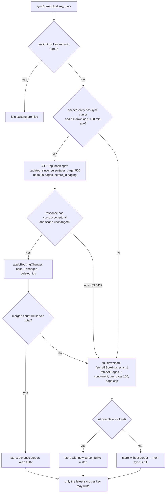

# Caching and Synchronization

> **Purpose:** Describe what the app caches, for how long, how caches are refreshed and invalidated, and what survives a relaunch, sign-out, account switch or location change.
> **Status:** Baseline (descriptive) — documents existing behaviour; not a requirements source
> **Last reviewed:** 2026-11-25
> **Inspected revisions:** Mobile `973d281`; Backend `zapzone-backend@ae877e2` (cited sections only)
> **Scope & limitations:** Read in full: `src/lib/bookings/bookingListCache.ts`, `src/lib/bookings/cacheOwner.ts`, `src/services/metricsCacheService.ts`, `src/lib/dashboard/timeframeStore.ts`, `src/lib/paymentsStale.ts`, `src/lib/hooks/useBookings.ts`. Read in part: `src/lib/hooks/useAttractions.ts`, `src/services/bookingsService.ts` (`fetchAllBookings`, `fetchBookingChanges`), `src/services/staffLocationService.ts` (`purgeLocationCaches`), `src/app/(tabs)/home.tsx` (live refresh). Other hook caches were identified by their cache-key definitions only; `src/lib/bookings/bookingSync.ts` (`applyBookingChanges`) was not read line-by-line (it is Test-backed). Backend `updated_since` / `sync` semantics: Not assessed.
> **Related:** [Architecture overview](../ARCHITECTURE.md) · [Business rules index](../BUSINESS_RULES.md) · [Known limitations](../KNOWN_LIMITATIONS.md) · [Startup, auth & session](startup-auth-and-session.md) · [API layer & data flow](api-layer-and-data-flow.md) · [Location & role access](location-and-role-access.md) · [Security & data handling](security-and-data-handling.md) · [Core platform rules](../business-rules/core-platform-rules.md)

---

## 1. Inventory

| Cache | Storage | Key / owner | Freshness | Invalidation | Evidence |
|---|---|---|---|---|---|
| Full booking list | memory `Map` | `locationId ?? "all"`; whole cache owned by the current **token** | 5 min (`CACHE_TTL_MS`) | token change (owner guard), `markBookingsStale()` (hard clear incl. in-flight), forced refetch | `src/lib/bookings/bookingListCache.ts` |
| Booking date windows | memory `Map`, LRU 24 | `scope|from|to` | 5 min | same as above; `generation` counter drops late results after a reset | same |
| Dashboard metrics | memory `Map` + JSON files in cache dir (`metrics-cache-v1-*`) | `metrics_<type>_<userId>_<location>_<timeframe>[_<venueDay>]` | 5 min (`CACHE_EXPIRY_MS`) | `clearAllCaches()` on account change, manager location change/launch reconcile, some purchase edits; expired files deleted lazily on read | `src/services/metricsCacheService.ts` |
| Attractions, attraction purchases, events, event purchases, fee supports, memberships, packages, waivers (pages) | module memory | `<userId>|<location>` (packages add kind) | 5 min where defined (e.g. `useAttractions`) | `mark*Stale()` / `clear*Cache()`; user id in key isolates accounts | `src/lib/hooks/use*.ts` cache-key definitions |
| Membership plans, waiver settings, brand logo | module memory | owner = current user id (`currentOwner`) | per hook | owner mismatch → treated as empty | `useMembershipPlans.ts`, `useWaiverSettings.ts`, `useBrandLogo.ts` |
| Space schedule, week booking counts | module memory | include user id + date + location | per hook | `clearSpaceScheduleCache()`, `clearWeekBookingCountsCache()` | `useSpaceSchedule.ts`, `useWeekBookingCounts.ts` |
| Special pricings | module memory | **`locationId ?? "all"` only (no user id)** | per hook | `markSpecialPricingsStale()` | `src/lib/hooks/useSpecialPricings.ts` |
| Visitor sessions | module memory | location key (user scoping Not assessed) | Not assessed | `clearVisitorSessionsCache()` | `src/services/visitorTrackingService.ts` |
| Blocked-period acknowledgements | module `Map` | user id + method + path + target fields | 5 min | never cleared by app code | `src/lib/blockedPeriodPrompt.ts` |
| Dashboard timeframe | memory + SecureStore `dashboard_timeframe_<userId>` | per user | persistent | reloaded after login/switch | `src/lib/dashboard/timeframeStore.ts` |
| Workspace location / theme / manager location preference | memory + SecureStore | global / per user | persistent | see location doc | `activeLocationStore.ts`, `theme.ts`, `staffLocationService.ts` |

## 2. Booking list incremental sync

- Full re-download at least every 30 minutes (`FULL_REFRESH_MS`) or whenever the change feed is refused, changes scope, or the merged count disagrees with the server's `total`.
- `fetchAllBookings` retries without `sync=1` if the server refuses sync with 403/422.
- Calendars request date windows; a fresh full list answers windows locally, never the reverse.
- `patchCachedBooking()` merges a field patch into every cached copy (full + windows) and notifies subscribers so lists repaint without refetch.
- Test-backed helpers: `src/lib/bookings/bookingSync.test.ts`, `src/lib/bookings/cacheOwner.test.ts`.

## 3. Refresh patterns

| Pattern | Behaviour | Example evidence |
|---|---|---|
| Stale-while-revalidate | Show cached rows immediately; refresh quietly if older than TTL. | `src/lib/hooks/useBookings.ts` (`sync`) |
| Pull-to-refresh | `refetch()` = forced sync. | `src/app/bookings/bookings.tsx` (`onRefresh`) |
| Focus refresh via stale flag | Mutating screens call `mark*Stale()`; list screens `useFocusEffect(() => consume*Stale() && refetch())`. Flags are one-shot module booleans. | `src/app/bookings/bookings.tsx`; `src/lib/paymentsStale.ts`; `src/lib/contactsStale.ts`, `src/lib/emailStale.ts`, `src/lib/membershipsStale.ts`, `src/lib/waivers/returningCustomersStale.ts` |
| Live polling | Home dashboard: while focused and foregrounded, silent refresh every 30 s (`LIVE_REFRESH_MS`); catch-up on refocus if older than one tick; refresh on `AppState` → active. | `src/app/(tabs)/home.tsx` |
| AppState active | Also used by `AuthGuard` (session window), calendar and space-schedule screens, kiosk components (not read in detail). | search for `AppState.addEventListener` |
| Request sequencing | `requestIdRef` counters so only the latest load writes state; caller `AbortSignal` → `neverSettles`. | `useAsyncList`, `useBookings`, `useLocationOptions` |

Interaction with the session window: every successful non-public `apiRequest` calls `touchSession()`, so the Home 30 s polling (assuming it goes through `apiRequest`, Inferred) keeps sliding the inactivity window while the dashboard is foregrounded — an unattended device on Home never idles out (**KL-SEC-001** context).

## 4. Persistence across launches

| Persists (SecureStore / files) | Memory only |
|---|---|
| Session token + user, saved accounts + tokens, workspace location, theme, per-user timeframe, manager location preference, metrics cache files, exported files in cache dir | Booking caches, all hook list caches, stale flags, blocked-period acknowledgements, push registration key, splash-played flag |

No list data is restored from disk on launch except dashboard metrics (if < 5 min old). There is no offline mode or mutation queue.

## 5. Purging on account / location change

| Event | What is purged | Evidence |
|---|---|---|
| Sign-out / any teardown (`clearSession`) | session keys, workspace location reset. Booking cache resets lazily on next access (token now null). **Metrics files and hook caches are not cleared** (hook caches are user-keyed). | `src/lib/session.ts` |
| Account change (`setSession` with a different user id) | workspace location reset, `metricsCacheService.clearAllCaches()`, booking cache (token owner), timeframe reload; `/switch-account` replaces the root so `(tabs)` remounts. | `src/lib/session.ts`; `src/lib/accounts/switchAccount.ts`; `src/app/switch-account.tsx` |
| Manager location switch | `purgeLocationCaches()`: bookings, attraction purchases, attractions, event purchases, events, fee supports, packages, special pricings, waivers marked stale; memberships, membership plans, space schedule, week counts, visitor sessions cleared; metrics cleared; then remount via `/switch-account`. | `src/services/staffLocationService.ts` (`purgeLocationCaches`, `switchStaffLocation`) |
| Manager launch reconcile finds a different active location | metrics cleared only. | `src/services/auth.ts` (`validateStoredSession`) |
| Company-admin workspace location change | no purge; consumers re-key by `locationId` and refetch reactively. | `src/lib/location/activeLocationStore.ts` |

Gap: `useSpecialPricings` keys only by location, so after an account switch on the same device the previous account's cached special pricings for the same key could be served while still fresh (**KL-ARCH-007**, Suspected; Device verification required).

## 6. Verification summary

| Topic | Implementation | Verification |
|---|---|---|
| Booking incremental sync | Implemented | Test-backed (`src/lib/bookings/bookingSync.test.ts`) for merge; flow Source-verified |
| Token-owned booking cache | Implemented | Test-backed (`src/lib/bookings/cacheOwner.test.ts`) |
| Metrics cache (memory + file) | Implemented | Source-verified |
| Stale flags | Implemented | Source-verified |
| Home live polling | Implemented | Source-verified |
| Account-scoped hook caches | Partially implemented (special pricings not user-keyed) | Source-verified (keys only) |
