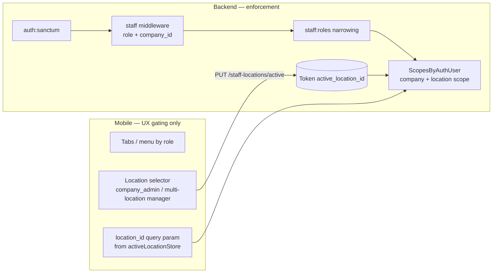

# Location and Role Access

> **Purpose:** Explain how roles and locations shape what the mobile app shows and requests, and separate client-side gating from what the backend actually enforces.
> **Status:** Baseline (descriptive) — documents existing behaviour; not a requirements source
> **Last reviewed:** 2026-11-25
> **Inspected revisions:** Mobile `973d281`; Backend `zapzone-backend@ae877e2` (cited sections only)
> **Scope & limitations:** Mobile: `src/services/auth.ts` (role type), `src/lib/navigation/navConfig.ts`, `src/lib/navigation/publicRoutes.ts`, `src/components/navigation/navMenuItems.ts`, `src/lib/location/*`, `src/services/staffLocationService.ts`, `src/services/locationsService.ts` (signatures), `src/lib/hooks/useLocationOptions.ts`, `src/components/ui/LocationWorkspaceSelector.tsx`, `src/lib/notifications/pushDevice.ts`. Backend: `routes/api.php` (auth groups, staff middleware, mobile routes), `app/Http/Middleware/EnsureStaff.php`, `app/Http/Traits/ScopesByAuthUser.php`, `app/Http/Controllers/Api/StaffLocationController.php`, `app/Support/StaffLocationSession.php` (signatures), `app/Models/User.php` (`canHoldSeveralLocations`, `canWorkAt`, `enterLocation`), `MobileAvailabilityController::getLocations`, `MobilePushDeviceController` (role constant). **Per-controller use of the scoping helpers was NOT audited** — 64 API controllers import `ScopesByAuthUser`, but whether each action applies it correctly is Not assessed. Individual screens' role checks (~90 files reference `.role`) were sampled, not audited.
> **Related:** [Architecture overview](../ARCHITECTURE.md) · [Business rules index](../BUSINESS_RULES.md) · [Known limitations](../KNOWN_LIMITATIONS.md) · [Startup, auth & session](startup-auth-and-session.md) · [API layer & data flow](api-layer-and-data-flow.md) · [Caching & synchronization](caching-and-synchronization.md) · [Security & data handling](security-and-data-handling.md) · [Core platform rules](../business-rules/core-platform-rules.md)

---

## 1. Roles

| Role string | Mobile type | Backend staff role | Location scoping (backend) | Notes |
|---|---|---|---|---|
| `company_admin` | in `UserRole` union | yes (`EnsureStaff::ROLES`, rank 3) | company-wide; optional `location_id` filter | Mobile's global workspace location selector is for this role only. |
| `admin` | **not** in the union (falls into `string & {}`) | yes (rank 3) | company-wide (not in the manager/attendant list in `ScopesByAuthUser`) | Mobile only names it in push eligibility; navigation treats it as an unlisted role (base tabs, no management item, no location selector). Whether `admin` accounts exist in practice: Not determined. See **KL-ARCH-004**. |
| `location_manager` | in union | yes (rank 2) | restricted to the token's active location; may hold several work locations | Only role allowed to switch location (`User::MULTI_LOCATION_ROLE`). |
| `attendant` | in union | yes (rank 1) | restricted to own location | No push registration; base tab set. |
| `customer` | — | no | — | Backend login rejects with 401 (`AuthController::login`). |

Evidence: `src/services/auth.ts` (`UserRole`); `zapzone-backend@ae877e2:app/Http/Middleware/EnsureStaff.php` (`ROLES`, `ROLE_RANK`, `effectiveRole`); `zapzone-backend@ae877e2:app/Http/Traits/ScopesByAuthUser.php`.

`EnsureStaff::effectiveRole` lets a PIN/terminal-minted token carry a `role:<name>` ability that can only **narrow** the account's role. The mobile app's own login tokens are plain `createToken` tokens (`AuthController::createTokenResponse`), so the account role applies (Inferred; terminal/PIN flows Not assessed).

## 2. Client-side gating (UX only — not authorization)

| Mechanism | Behaviour | Evidence |
|---|---|---|
| Route guard | Unauthenticated users are redirected off any route except `/`, `/splash*`, `/switch-account*`. No role check at the route level. | `src/components/AuthGuard.tsx`, `src/lib/navigation/publicRoutes.ts` (`isPublicRoute`) |
| Bottom tabs | `company_admin` and any unlisted role (incl. `attendant`, `admin`): home, location, navigation, calendar, accounts. `location_manager`: home, **activity** (instead of location), navigation, calendar, accounts. Read reactively via `useCurrentUserRole()`. | `src/lib/navigation/navConfig.ts` (`ROLE_TABS`, `getRoleTabs`), `src/app/(tabs)/_layout.tsx`; Test-backed: `src/lib/navigation/navConfig.test.ts` |
| Quick-nav menu | Same module list for all roles; adds "User Management" (company_admin) or "Attendants Management" (location_manager) — both route to the same hub; none for others. | `src/components/navigation/navMenuItems.ts` (`getNavMenuItems`) |
| Location selector | Renders only for `company_admin` (workspace filter) or a manager with >1 work location (server switch). | `src/components/ui/LocationWorkspaceSelector.tsx` |
| Per-screen checks | Many screens hide/disable actions with `getCurrentUser()?.role === "company_admin"` etc. (sampled: bookings, packages, photos, waivers, user-management). These read a non-reactive snapshot at render. | e.g. `src/app/bookings/bookings.tsx` (`isCompanyAdmin`) |
| Push eligibility | `company_admin`, `admin`, `location_manager`; mirrors backend `MobilePushDeviceController::ALLOWED_ROLES`. | `src/lib/notifications/pushDevice.ts`; `zapzone-backend@ae877e2:app/Http/Controllers/Api/MobilePushDeviceController.php` |

No module screen is unreachable for a role by deep link or route push; the menu simply omits entries. Any protection beyond hiding UI must come from the backend (BR-ROLE-001).

## 3. Global active location (company admin workspace)

`src/lib/location/activeLocationStore.ts`:
- Module state `{ id: number | "all", name }`, default `"all"`; reactive via `useActiveLocation()` (`useSyncExternalStore`); persisted best-effort to SecureStore `zapzone_active_location`; rehydrated at launch by `restoreActiveLocation()` in the root layout.
- `getActiveLocationId()` → number or `undefined` (callers omit `location_id` for "all"). `defaultFormLocationId(own)` → active location, else the user's own, else null (new records / on-site sales).
- Reset to "All Locations" by `resetActiveLocation()` from `clearSession()` (every sign-out/teardown) and from `setSession()` when the account changes (add/switch account, signed-out cold login). A **restored** session keeps the persisted selection.
- Only `company_admin` can change it (selector gating). For other roles it stays "all", so consumers send no `location_id` and the backend scopes them.
- Consumers: ~59 files call `useActiveLocation()` / `getActiveLocationId()` / `defaultFormLocationId()` (dashboard tabs, bookings, calendars, attractions, events, packages, pricing, photos, payments, waivers, analytics, activity logs, day-offs, etc.).

Exception: on Manage Bookings, export/report/import use `currentUser.location_id` (`scopeLocationId`), not the active workspace location, so a company admin's export scope can differ from the list on screen (`src/app/bookings/bookings.tsx`). See **KL-ARCH-006**.

## 4. Location options list

- `fetchLocations(token)` → `apiRequest GET /api/mobile/locations` (`src/services/locationsService.ts`); `fetchLocationById` reads from the same list. `useLocationOptions()` loads it once per mount, best-effort (`src/lib/hooks/useLocationOptions.ts`).
- Historical reason (per code comments): the full `/api/locations` payload is heavy; the mobile endpoint returns scalar columns only.
- **Backend reality:** `GET /api/mobile/locations` is registered in the **public** `mobile` prefix group (no `auth:sanctum`) and `MobileAvailabilityController::getLocations` returns **all active locations of every company** (`id, name, address, city, state, zip_code, phone, email, timezone, logo_path`) with no company filter (`zapzone-backend@ae877e2:routes/api.php` `Route::prefix('mobile')`, `app/Http/Controllers/Api/MobileAvailabilityController.php` `getLocations`). In a multi-company deployment a company admin's picker would list other companies' locations. Whether selecting one would leak data depends on each controller's company guard (`guardCompanyAccess` / `scopedLocation`) — Not assessed per controller. See **KL-SEC-003**.

## 5. Manager work locations (server-held active location)

| Aspect | Behaviour | Evidence |
|---|---|---|
| Where the active location lives | On the Sanctum personal access token (`active_location_id`). A `TokenAuthenticated` listener re-applies it every request via `User::enterLocation`, which only succeeds for the multi-location role and an assigned location; otherwise the token's value is cleared. | `zapzone-backend@ae877e2:app/Providers/AppServiceProvider.php` (`boot`), `app/Support/StaffLocationSession.php` (`handle`, `remember`), `app/Models/User.php` (`enterLocation`, `canWorkAt`, `workLocationIds`) |
| Switch endpoint | `PUT /api/staff-locations/active` (behind `auth:sanctum` + `staff`): 403 unless `canHoldSeveralLocations()`; 403 if not `canWorkAt`; 422 if not a PAT; 503 before migration; logs "Location Switched". | `StaffLocationController::activate` |
| State endpoint | `GET /api/staff-locations` → `active_location_id`, `active_location_name`, `home_location_id`, `can_switch`, `locations`. `/api/user` merges the same `locationAccessPayload()`. | `StaffLocationController::index/state`; `routes/api.php` `/user` closure |
| Mobile mirror | `withStaffLocation()` rewrites `location_id`, `location`, `home_location_id`, `work_locations` on the session user; `canSwitchLocation()` = more than one work location. | `src/lib/location/staffLocation.ts` (Test-backed: `src/lib/location/staffLocation.test.ts`) |
| Re-sync points | Login (reopen last device choice), launch (`/api/user`), account switch (`/api/staff-locations`), in-app switch (purge caches + `/switch-account` remount). | see [startup-auth-and-session.md §6](startup-auth-and-session.md) |
| Wrong-location records | Backend may answer 403 with `switch_location_id` and "Switch to X in the sidebar" (`ScopesByAuthUser::denyForeignRecord`, `guardLocationAccess`, `denyStaffElsewhere`); mobile `RegistrationLoadFailure` offers a switch using it (`src/components/events/RegistrationLoadFailure.tsx`). Other screens' handling: Not assessed. |

## 6. What the backend enforces

| Layer | Enforcement | Evidence | Status |
|---|---|---|---|
| Authentication | `auth:sanctum` on the protected group; JSON 401 "Unauthenticated." for API routes; tokens of `inactive` users rejected; no token expiry. | `routes/api.php` line ~263 group; `bootstrap/app.php` exception render; `AppServiceProvider::boot`; `config/sanctum.php` | Server-enforced |
| Staff-only gate | `staff` middleware: requires a `User` in `company_admin/admin/location_manager/attendant` **and** non-null `company_id`, else 403; `staff:a|b` narrows by effective role. Applied to most staff endpoints but **not every** route in the auth group (e.g. `ticket-orders` index/show, `categories` index, `mobile/packages`, `mobile/push-devices` have no `staff` middleware at the route level). | `app/Http/Middleware/EnsureStaff.php`; `routes/api.php` | Server-enforced where applied; per-route completeness Not assessed |
| Role-restricted writes | e.g. custom-field writes, companies store/update/destroy, location update/destroy, categories CRUD, mobile version admin: `staff:company_admin|admin|location_manager`; staff-PIN roster/terminals: `staff:company_admin|location_manager`. | `routes/api.php` | Server-enforced |
| Company scoping | `applyAuthScope` adds `company_id = user.company_id` when the column exists; `guardCompanyAccess`/`scopedLocation` deny other companies. | `ScopesByAuthUser` | Mechanism server-side; per-action use Not assessed |
| Location scoping | For `location_manager`/`attendant`: `location_id = user.location_id` (the token's active location for managers) on queries and record checks; company admins are not location-restricted. | `ScopesByAuthUser::applyAuthScope`, `authorizeRecordScope`, `guardLocationAccess` | Mechanism server-side; per-action use Not assessed |
| Unauthenticated principal | `applyAuthScope` **returns without scoping** when no `User` is resolved — the reason `staff` middleware exists ("fails CLOSED"). Any route that uses the trait without `staff`/auth would be unscoped. | `EnsureStaff` docblock; `ScopesByAuthUser::applyAuthScope` | Server design; exposure Not assessed |
| Push devices | Controller-level role allow-list (`ALLOWED_ROLES`) returning 403. | `MobilePushDeviceController` | Server-enforced (constant read; method body Not assessed) |

## 7. Implementation / verification summary

| Item | Implementation | Verification |
|---|---|---|
| Role-based tabs/menu | Implemented | Test-backed (`src/lib/navigation/navConfig.test.ts`) for tabs; menu Source-verified |
| `admin` role handling on mobile | Partially implemented (push only) | Source-verified |
| Company-admin workspace location | Implemented | Source-verified |
| Manager server-held active location + switch | Implemented | Source-verified (backend + mobile); pure helpers Test-backed |
| Location list scoping (`/api/mobile/locations`) | Not implemented (unscoped, public) | Source-verified |
| Backend staff gate & scoping mechanisms | Implemented | Source-verified (mechanism); per-controller application Not assessed |
