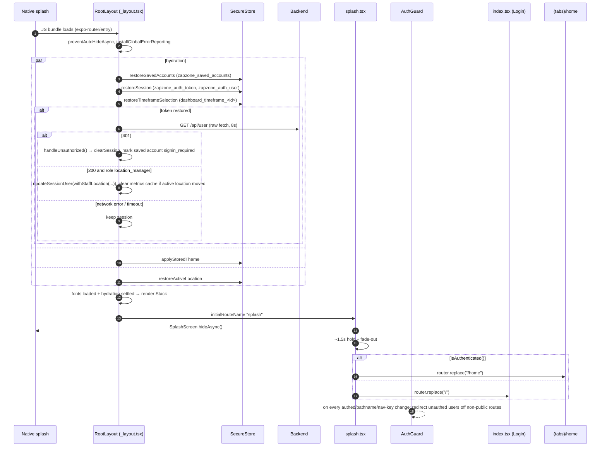
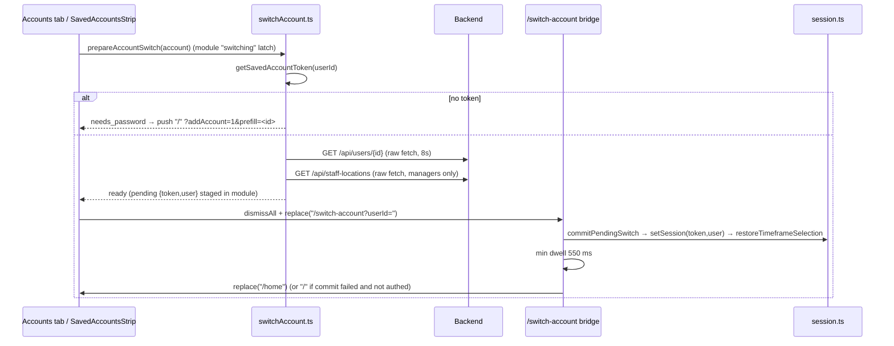

# Startup, Authentication and Session

> **Purpose:** Describe how the app boots, hydrates persisted state, authenticates staff, keeps/ends a session, and switches between saved accounts and manager locations.
> **Status:** Baseline (descriptive) — documents existing behaviour; not a requirements source
> **Last reviewed:** 2026-11-25
> **Inspected revisions:** Mobile `973d281`; Backend `zapzone-backend@ae877e2` (cited sections only)
> **Scope & limitations:** Static source inspection of the mobile root layout, splash/login/switch-account routes, `AuthGuard`, session/saved-account/staff-location modules, auth service and push-device registration; backend `AuthController`, `EnsureStaff`, `StaffLocationController`, `StaffLocationSession`, `AppServiceProvider` and `config/sanctum.php`. Nothing was executed; no device runs. `PushNotificationRouter` cold-start navigation and `AppUpdateGate` internals were only skimmed (Not assessed in depth).
> **Related:** [Architecture overview](../ARCHITECTURE.md) · [Business rules index](../BUSINESS_RULES.md) · [Known limitations](../KNOWN_LIMITATIONS.md) · [API layer & data flow](api-layer-and-data-flow.md) · [Location & role access](location-and-role-access.md) · [Caching & synchronization](caching-and-synchronization.md) · [Security & data handling](security-and-data-handling.md) · [Core platform rules](../business-rules/core-platform-rules.md)

---

## 1. Entry point and root layout

| Step | What happens | Evidence |
|---|---|---|
| Bundle entry | `package.json` `"main": "expo-router/entry"`; Expo Router file-based routes under `src/app`. | `package.json` |
| Module scope (before first render) | `SplashScreen.preventAutoHideAsync()`, `applyMontserratDefault()`, `installGlobalErrorReporting()` (global JS error + Hermes unhandled-rejection hooks → `POST /api/client-errors`). `unstable_settings.initialRouteName = "splash"`. | `src/app/_layout.tsx` (module scope), `src/lib/errorReporting.ts` (`installGlobalErrorReporting`) |
| Hydration gate | `RootLayout` renders `null` until **both** `useFonts(montserratFonts)` resolves **and** the hydration `Promise.all` settles (`.finally` → `setSessionRestored(true)`). A hydration failure still mounts the app (`finally`). | `src/app/_layout.tsx` (`RootLayout`) |
| Mounted tree | `GestureHandlerRootView` → `ErrorBoundary` → `StatusBar`, `AuthGuard`, `PushDeviceRegistrar`, `PushNotificationRouter`, `<Stack>` (screens `splash`, `index`, `(tabs)`, `switch-account` with cross-fade `AUTH_SCREEN_OPTIONS`), `AppUpdateGate`, `ChangeReasonHost`, `BlockedPeriodHost`. | `src/app/_layout.tsx` |

### 1.1 Hydration order (inside the root `useEffect`)

```
Promise.all([
  restoreSavedAccounts()                         // SecureStore index of saved accounts
    .then(() => restoreSession()                 // token + user from SecureStore
      .then(async restored => {
        await restoreTimeframeSelection();       // per-user dashboard timeframe
        return restored ? validateStoredSession() : undefined;  // GET /api/user (8s)
      })),
  applyStoredTheme(),                            // SecureStore "zapzone_theme"
  restoreActiveLocation(),                       // SecureStore "zapzone_active_location"
]).finally(() => setSessionRestored(true));
```

- Saved accounts are restored **before** the session so `restoreSession`'s self-healing `upsertSavedAccount` sees existing entries (`src/lib/session.ts` `restoreSession`).
- `restoreActiveLocation` runs in parallel and writes module state directly (no listener notify) (`src/lib/location/activeLocationStore.ts` `restoreActiveLocation`).
- `validateStoredSession` is the only network call that gates first paint; it is capped at 8 s (`VALIDATE_TIMEOUT_MS`) and treats network failure as "keep session" (`src/services/auth.ts` `validateStoredSession`).

### 1.2 Startup sequence



### 1.3 Splash → login hand-off (current design)

- `splash.tsx` is the **single authority** for the launch hand-off: after a 1.5 s hold and fade it calls `router.replace(isAuthenticated() ? "/home" : "/")`, once, and only if the instance is focused (`handedOffRef`, `focusedRef`). (`src/app/splash.tsx` `handOff`)
- `index.tsx` (Login) **owns no authenticated navigation**. It redirects to `/splash` only if the splash has not played in this JS runtime (`hasPlayedSplash()`), otherwise renders the form. Route params (`addAccount`, `prefill`, `notice`) are snapshotted once in `useState`. (`src/app/index.tsx` `HomeScreen`)
- History: an earlier design had the login screen keep a mount-time auth snapshot and `<Redirect href="/home">`, which competed with `AuthGuard` and was implicated in a "Maximum update depth exceeded" loop. That redirect was removed; the in-code comments in `src/app/index.tsx` and `src/app/splash.tsx` explain why. The historical investigation is `docs/MAX_UPDATE_DEPTH_DEBUG_REPORT.md` (explicitly marked HISTORICAL; root cause recorded there as *not fully confirmed*). Whether the loop is gone on device: **Device verification required**.

## 2. AuthGuard (client-side route protection)

`src/components/AuthGuard.tsx` (`AuthGuard`) renders `null` and runs three effects:

1. **Redirect effect** (deps `authed`, `pathname`, `navState.key`, `router`):
   - Skips until the root navigator has a key.
   - If authed or on a public route (`isPublicRoute`: `/`, `/splash*`, `/switch-account*` — `src/lib/navigation/publicRoutes.ts`), re-arms `redirectedRef` and returns.
   - Otherwise, **re-checks `isAuthenticated()` live** (the closure value can be stale because `setSession` sets the token synchronously but notifies after awaited SecureStore writes); if still unauthed, sets `redirectedRef`, `router.dismissAll()` when possible, then `router.replace("/")`.
2. **Activity touch**: on `authed`/`pathname` change, `touchSession()`.
3. **Inactivity enforcement** (while authed): `registerAppResume()` on entering authed state and on every `AppState` → `active`; a 60 s interval (`EXPIRY_CHECK_INTERVAL_MS`) calls `expireSession()` if the app is foregrounded and `isSessionExpired()`. The interval only checks; it never extends.

This is **client-side UX gating only**. Every protected backend route is independently guarded by `auth:sanctum` (+ `staff` middleware for most staff endpoints) — see [location-and-role-access.md](location-and-role-access.md).

## 3. Session store (`src/lib/session.ts`)

### 3.1 State and persistence

| Item | Where | Notes |
|---|---|---|
| Bearer token | memory `authToken` + SecureStore `zapzone_auth_token` | Default keychain accessibility (no `keychainAccessible` option passed). |
| User record | memory `authUser` (full) + SecureStore `zapzone_auth_user` | `persistableUser` drops `profile_path` (can be ~27 MB base64) before persisting. |
| Expiry | memory `expiresAt` + SecureStore `zapzone_auth_expires_at` | Written on set/touch/resume; **never read back** — `restoreSession` always starts a fresh window. |
| End reason | memory `endReason` (`"expired"`/`"unauthorized"`/null) | Consumed once by the login screen (`consumeSessionExpiredNotice`). |
| Single-logout latch | memory `sessionInvalidated` | Reset only by `setSession`/`restoreSession`. |

Reactivity: a listener set + `useSyncExternalStore` hooks — `useAuthStatus()` (snapshot = token identity, returns `isAuthenticated()`), `useCurrentUserId()`, `useCurrentUserRole()`. `touchSession` deliberately does **not** notify.

### 3.2 Session window (TTL)

- `SESSION_TTL_MS = 30 * 24 * 60 * 60 * 1000` (30 days), commented `// TEMP: 30-day session while debugging the login nav bug; was 60 * 60 * 1000 (1h).` Several comments in the same file and in `AuthGuard` still say "1h". See **KL-SEC-001**.
- Sliding window: `touchSession()` (called after every successful non-public `apiRequest` and on authed route changes) moves `expiresAt` to now + TTL unless already expired; SecureStore write throttled to once per 60 s (`EXPIRY_PERSIST_THROTTLE_MS`).
- `registerAppResume()` (authed mount + every foreground) **revives even a lapsed window** — only idle time while the app is open and foregrounded can expire a session. Combined with `restoreSession` ignoring the stored expiry, a backgrounded/closed app never expires locally.
- `isAuthenticated()` = token present **and** `now < expiresAt`.
- Server side, Sanctum tokens have no expiry (`zapzone-backend@ae877e2:config/sanctum.php` `'expiration' => null`); tokens of users whose `status` is `inactive` fail authentication (`zapzone-backend@ae877e2:app/Providers/AppServiceProvider.php` `Sanctum::authenticateAccessTokensUsing`). The local TTL is therefore a **client-side lock only**.

### 3.3 Teardown matrix

| Trigger | Function | Saved account effect | Latch | Login notice |
|---|---|---|---|---|
| Any 401 on an authenticated, non-public `apiRequest` whose token is still current | `handleUnauthorized` → `invalidateSession("unauthorized")` | `markAccountSignInRequired` (token deleted, state `signin_required`) | set | "Your session expired" |
| Launch `GET /api/user` → 401 | `handleUnauthorized` (from `validateStoredSession`) | same | set | yes |
| Foreground idle past TTL | `expireSession` → `invalidateSession("expired")` | **unchanged** (stays `linked`, token kept) | set | yes |
| Explicit Sign Out | `signOut` (see §4.3) | `markAccountSignInRequired` | not set | none |
| Remove account (active) | Accounts tab `removeAccount` | removed entirely | not set | none |

`clearSession()` itself is neutral about saved accounts; it nulls memory state, calls `resetActiveLocation()`, deletes the three SecureStore keys (best-effort) and notifies. `invalidateSession` is idempotent behind the latch so many parallel 401s cause one teardown. While latched, `apiRequest` silently drops any request that carries a token (`neverSettles`) — see [api-layer-and-data-flow.md](api-layer-and-data-flow.md).

## 4. Login, logout and token checks (`src/services/auth.ts`)

### 4.1 Login

- `LoginForm.handleSubmit` (`src/components/auth/LoginForm.tsx`): client validation (email regex, password ≥ 8 chars — mirrors backend `min:8`), `submitting` guard against double submit → `login()` = `apiRequest("/api/login", { method: "POST", body })` **with no token and without `publicEndpoint`** → `resolveStaffLocation(token, user, { reopen: true })` → `setSession` → `restoreTimeframeSelection` → `router.replace("/home")` (or `onSuccess` for add-account).
- Error mapping: 429 → throttling copy; 422 with `fieldErrors` → field errors; other `ApiError` → message banner.
- Backend: `POST /api/login` is throttled (`throttle:sign-in`); wrong credentials **or a `customer` role** return **401** with message "The provided credentials are incorrect."; `status === 'inactive'` returns 403; success returns `{ user (with locationAccessPayload), role, token }` from `createToken`. (`zapzone-backend@ae877e2:app/Http/Controllers/Api/AuthController.php` `AuthController::login`, `createTokenResponse`; `routes/api.php` line ~80)
- **Defect (KL-ARCH-001):** because `apiRequest` treats every non-public 401 as session death (and `isStaleSessionReply(undefined, …)` is `false` — `src/lib/staleSessionReply.test.ts` "leaves unauthenticated requests to the normal rules"), a wrong-password login calls `handleUnauthorized()` and returns a never-settling promise. Statically: the form's `submitting` never resets (spinner/disabled inputs), and in the *add-account* flow the **currently live session is torn down** and that account marked `signin_required`. The 401 copy is never shown. **Device verification required** for the exact UX.
- No mobile-side role allow-list at login: any non-customer `User` role the backend accepts can sign in. Server-side, staff endpoints are gated by `EnsureStaff` (roles `company_admin`, `admin`, `location_manager`, `attendant` + non-null `company_id`).

### 4.2 Launch validation — `validateStoredSession`

Raw `fetch` to `GET /api/user` (bypasses `apiRequest` because its never-settle 401 path would hang startup). 401 → `handleUnauthorized()`. 200 + `location_manager` → reconcile the token's active location (`stateFromUserPayload` → `withStaffLocation` → `updateSessionUser`), clearing the metrics cache if the active location differs from the stored one. Any network error/timeout keeps the session. The backend `/user` closure returns `user->toArray()` merged with `locationAccessPayload()` (`zapzone-backend@ae877e2:routes/api.php` `Route::get('/user', …)`).

### 4.3 Sign out — `signOut` / `useLogout`

Order (`src/services/auth.ts` `signOut`):
1. `unregisterCurrentPushDevice(token)` — raw-fetch `DELETE /api/mobile/push-devices` with 8 s timeout, errors swallowed (`src/services/pushDeviceService.ts` `unregisterPushDevice`). Must precede revoke because the endpoint is authenticated.
2. `revokeToken(token)` — raw-fetch `POST /api/logout`, 8 s timeout, errors swallowed (server deletes only that bearer and logs "User Logout").
3. `markAccountSignInRequired(userId)` — keeps the saved account, deletes its stored token.
4. `clearSession()`.

`useLogout` (`src/lib/hooks/useLogout.ts`) wraps this with a `loggingOut` guard and always `router.replace("/")` in `finally` (even if `signOut` rejects; a rejection is re-thrown). Used by Profile and the Accounts tab.

Both raw fetches bypass `apiRequest` deliberately: a dead bearer's 401 would otherwise trigger `handleUnauthorized` and a never-settling promise, hanging logout.

## 5. Saved accounts and account switching

### 5.1 Store (`src/lib/accounts/savedAccountsStore.ts`)

- Index in SecureStore `zapzone_saved_accounts` (`{ v: 1, accounts: SavedAccount[] }`): user id, name, email, role, initials, company id/name, location name, short `avatarPath` (≤ 200 chars), `tokenState`, timestamps.
- Per-account token in SecureStore `zapzone_saved_token_<userId>` with `keychainAccessible: WHEN_UNLOCKED_THIS_DEVICE_ONLY`.
- `MAX_SAVED_ACCOUNTS = 5`; on overflow, evicts `signin_required` first, then least-recently used, deleting its token.
- `tokenState`: `linked` (token stored) vs `signin_required` (token deleted). `getSavedAccountToken` self-heals a `linked` entry with a missing token to `signin_required`.
- **Every session is auto-saved**: `setSession`, `updateSessionUser` and `restoreSession` all call `upsertSavedAccount`. There is no opt-out; the login form's `rememberMe` state is unused (no rendered control).

### 5.2 Sign Out ≠ Remove

| Action | Where | Effect |
|---|---|---|
| Sign Out (active) | `useLogout` → `signOut` | push unregister → revoke → `signin_required` → `clearSession` |
| Remove (active) | `src/app/(tabs)/accounts.tsx` `removeAccount` | push unregister → revoke → `removeSavedAccount` → `clearSession` |
| Remove (inactive, linked) | Accounts tab / `src/components/auth/SavedAccountsStrip.tsx` | revoke stored token → `removeSavedAccount` |
| Remove (signin_required) | same | `removeSavedAccount` only |

### 5.3 Switch flow



- Validation uses raw `fetch` (`fetchUserWithToken`) so a dead saved token's 401 can't tear down the **live** account via `handleUnauthorized`. Failure kinds: `unauthorized` (→ `signin_required`, needs password), `inactive` (`user.status !== "active"` → `signin_required`, error), `network`, `server`.
- `GET /api/users/{id}` returns the **home** location; `resolveStaffLocation` (no `reopen`) then asks `GET /api/staff-locations` for the token's active location (`src/lib/accounts/switchAccount.ts` comment; `src/services/staffLocationService.ts` `resolveStaffLocation`).
- The bridge route exists to **replace the stack root and unmount `(tabs)`**, so the new account gets fresh screens. It blocks Android hardware back. It is a public route for `AuthGuard`. (`src/app/switch-account.tsx`)
- `setSession` detects an account change (`authUser?.id !== user.id`) and then `resetActiveLocation()` + `metricsCacheService.clearAllCaches()`. Booking list cache is token-owned and resets on the token change (see [caching-and-synchronization.md](caching-and-synchronization.md)).
- In-flight replies for the previous token are ignored on 401 (`isStaleSessionReply`).
- Add-account: Accounts tab pushes `/?addAccount=1`; on success `index.tsx` `handleAccountAdded` dismisses and replaces to `/switch-account?userId=` (nothing pending, so the bridge just remounts — `committed || isAuthenticated()`).

### 5.4 Inactivity lock vs. saved accounts

After an `expired` teardown the account stays `linked` with its token stored; the login screen's `SavedAccountsStrip` can resume it via `prepareAccountSwitch` **without a password**. The inactivity timeout therefore does not force re-authentication for saved accounts (and all sessions are saved). See **KL-SEC-002**.

## 6. Manager multi-location re-sync

The backend keeps a manager's active location **on the personal access token** (`active_location_id`), applied on every authenticated request by a `TokenAuthenticated` listener that calls `User::enterLocation` (`zapzone-backend@ae877e2:app/Support/StaffLocationSession.php` `handle`, registered in `AppServiceProvider::boot`). The app mirrors it:

| Moment | Mechanism | Evidence |
|---|---|---|
| Login | `resolveStaffLocation(token, user, { reopen: true })`: reopens the last location picked on this device (SecureStore `zapzone_manager_location_<userId>`) if still assigned, via raw `PUT /api/staff-locations/active`; else keeps the login payload. | `src/services/staffLocationService.ts`, `src/lib/location/staffLocation.ts` `reopenTarget` |
| Launch | `validateStoredSession` reconciles from `GET /api/user`. | `src/services/auth.ts` |
| Account switch | `resolveStaffLocation` (no reopen) → `GET /api/staff-locations`. | `src/lib/accounts/switchAccount.ts` |
| In-app switch | `switchStaffLocation` → `apiRequest PUT /api/staff-locations/active` → purge location caches → `updateSessionUser` → remember preference → bridge `/switch-account?locationName=` remounts. | `src/services/staffLocationService.ts` `switchStaffLocation`; `src/components/ui/LocationWorkspaceSelector.tsx` `switchTo`; `src/components/events/RegistrationLoadFailure.tsx` |

Server enforcement: `StaffLocationController::activate` rejects non-managers (403), unassigned locations (`canWorkAt` → 403), and non-PAT sessions (422). Details in [location-and-role-access.md](location-and-role-access.md).

## 7. Push device registration (session-coupled)

- `PushDeviceRegistrar` (root) calls `syncPushDeviceRegistration()` when authed and the role is eligible; resets the registration key when signed out. (`src/components/PushDeviceRegistrar.tsx`)
- Eligible roles: `company_admin`, `admin`, `location_manager` (comment says it mirrors the backend controller's `ALLOWED_ROLES`; backend controller **Not assessed**). Requires a physical device, not Expo Go on Android, granted permission, and an EAS `projectId`. Registration uses `apiRequest POST /api/mobile/push-devices`. (`src/lib/notifications/pushDevice.ts`)
- Logout/remove-active unregister before revoke (§4.3). On an involuntary 401/expiry teardown **no unregister call is made**; the server row stays active until a later registration (comment in `unregisterPushDevice`). See **KL-SEC-005**.

## 8. TEMP debug instrumentation

- `src/lib/debug/authDebug.ts` (`authDebug`): `__DEV__`-only `console.log` of auth/navigation events with a live session snapshot (authed, hasToken, userId, latch, minutes to expiry). It never logs the token value.
- Call sites carry `// TEMP: investigation instrumentation — see docs/MAX_UPDATE_DEPTH_DEBUG_REPORT.md`: `src/lib/api.ts`, `src/lib/session.ts`, `src/services/auth.ts`, `src/app/_layout.tsx`, `src/app/splash.tsx`, `src/app/index.tsx`, `src/app/switch-account.tsx`, `src/components/AuthGuard.tsx`, `src/components/auth/LoginForm.tsx`, `src/lib/hooks/useLogout.ts`. `AuthGuard` also keeps a module render counter and `prevDepsRef` purely for tracing. `useAuthStatus` additionally runs `console.count` under `__DEV__`.
- Not shipped to release logs (guarded by `__DEV__`), but it is acknowledged temporary scaffolding (**KL-ARCH-005**).

## 9. Verification summary

| Topic | Implementation | Verification |
|---|---|---|
| Hydration order / gate | Implemented | Source-verified |
| Splash single hand-off | Implemented | Source-verified; loop absence: Device verification required |
| AuthGuard redirect + live re-check | Implemented | Source-verified |
| Sliding inactivity window | Implemented (30-day TEMP TTL) | Source-verified |
| 401 single-logout latch | Implemented | Source-verified |
| Stale-session 401 guard | Implemented | Test-backed (`src/lib/staleSessionReply.test.ts`) for the predicate only |
| Saved accounts / switching | Implemented | Source-verified (no tests found for `savedAccountsStore`/`switchAccount`) |
| Manager location reopen/reconcile | Implemented | Test-backed for pure helpers (`src/lib/location/staffLocation.test.ts`); network flow Source-verified |
| Wrong-password login handling | Partially implemented (defect KL-ARCH-001) | Source-verified; Device verification required |
| Push unregister-before-revoke | Implemented | Source-verified |

No unit tests were found for `src/lib/session.ts`, `src/lib/api.ts`, `src/lib/accounts/*` or `src/components/AuthGuard.tsx` (**KL-ARCH-008**, testing gap).
